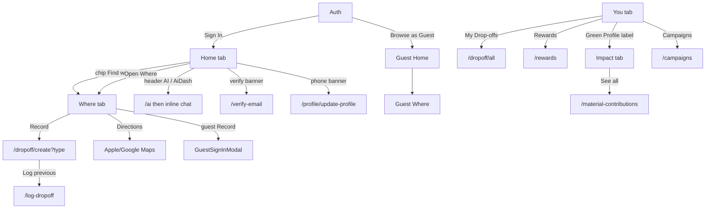

# Consumer visual replica

Source of truth: `natcycle/client` git **`main`** only (`b627d0a` — *Make zoomed-out Where map markers a bit larger.*).

Read web with `git show main:PATH`. Do not import from `client/`. Do not copy the working tree (`feat/waste-ed-set-of-changes`).

Out of scope: `/company/*`, `/admin/*`, pickup-ops.

Guest on web is **route-based** (`pathname.startsWith("/guest")`), not a fake JWT. Browse as Guest goes to `/guest/dashboard` with no bearer token.

## Tokens (`main`)

Put values in `src/shared/theme`. Screens compose components; they do not invent hex.

| Token | Value |
| --- | --- |
| Font | DM Sans |
| Page bg | `#fbfbfb` |
| Ink | `#111111` / `#1A1A1A` |
| Brand green | `#204C27` |
| Lime | `#D3FF5D` / `#D4FF4F` / `#D1FF52` / `#B8E83A` |
| Auth column | `px-4`, `max-w-[450px]` |
| App column | `max-w-[550px]`, `px-4`, `pb-24` |
| Fields | `px-4 py-3.5`, 16px, `#1A1A1A`, placeholder slate-400 |
| `rounded-2xl` | **16** |
| Cards | 16 / 24 / 28 — not 20 |
| Glass tab bar | `rounded-[28px]`, `rgba(255,255,255,0.55)`, blur 20, saturate 180, shadow `0 8px 40px rgba(15,23,42,0.12)` |
| Active tab | 40px disc `#111111` |
| Global `.button` | lime `#D3FF5D`, black text, `py-4`, `rounded-2xl`, `shadow-sm` |

Do not treat Tailwind `green-500` (`#22c55e`) as brand. Verify Email uses that default on `main`.

Two visual eras: lime/glass (Home, Impact, Profile, Where) vs older `rounded-lg` / `shadow-md` (forgot, history, UpdateProfile). Match each page as it is.

## Click-through

Hubs: auth + four tabs (Home / Impact / Where / You). Drop-off and Rewards are **pushed screens**.

Query strings to preserve: `type`, `mode`, `locationId`, `campaignId`, `organization`.

**Mislabels on `main` (copy behavior):** Profile “Green Profile” → `/impact`. Home AI → `/ai` (inline chat), not `/ai-chat`.

**Defer until a hub links them:** `/pickup/book`, `/green-profile`, `/ai-chat`, `/campaigns/:id/contributors`, unused `QRScanButton`.

**Notifications (`/notifications`):** In-app inbox matches web list (`GET /notifications`). Profile → Account Settings → Notifications. Native push via `expo-notifications` + `POST /user/fcm-token` (device FCM/APNs token). Enable push on the notifications screen or auto-register after sign-in.

**Do not port Home leftovers:** `Campaigns`, `RewardSwiper`, `Milestone`, `ActionCardButtons`.

**Do not copy** drop-off success modal debug red/yellow chrome on `main`.

## Screen notes

- **Sign in** (`/`): inherit `#fbfbfb`, column `15vh` from top (not centered), logo 152px, illustration `min(24vh, 8rem)`, title 22px semibold `#111111`, field card `rounded-2xl` **no shadow**, 17px eyes, split CTA, ThingsMatch `tmMark` 24×16. Guest → `/guest/dashboard`.
- **Signup:** same 450px shell, `5vh` top, cards **have** `shadow-sm`, no illustration, no ThingsMatch.
- **Forgot / reset:** older lime `.button`, logo 224px.
- **Home:** Safari banner (iPhone Safari web only) → Green Impact card → dispose card → AiDash. Guest hides CU count, uses `/guest/where`, and locks AI behind GuestSignInModal. Phone banner → `/profile/update-profile`.
- **Where:** Mapbox `streets-v12` full-bleed map, colored markers (scale with zoom), Diversion Points / Events cards, chips, search, org + type filters. Record carries `type` (and `mode=simple&locationId=` for static drop-offs). Guest Record / event reminder open GuestSignInModal. Directions opens Apple/Google Maps. Needs a native APK/dev client — not Expo Go.
- **Create drop-off CTA:** slate-800 `rounded-full`, not lime. Log previous is a 3-step wizard then `/impact`. Live create returns `/home` with the white share success modal (no debug chrome).
- **You / Profile:** avatar, NatPoints / CU, Activity rows (My Drop-offs, Rewards, Green Profile → `/impact`, Campaigns), Update Profile, Logout, ThingsMatch.
- **Impact:** stats pill, lime breakdown, Green Commits heatmap, Action Map, See all → `/material-contributions`.
- **AI (`/ai`):** Diva landing (capabilities + Quick knowledge) → inline chat via `POST {AI}/ask` + history `/chat`. Home suggestions open `/ai?q=&suggestionId=`. Guest locks AI.
- **Campaign detail:** materials, urgent, progress, selectable collection locations, **Support This Campaign** → create with `mode=campaign`.

See also: [MAPBOX_AND_APK.md](./MAPBOX_AND_APK.md).
